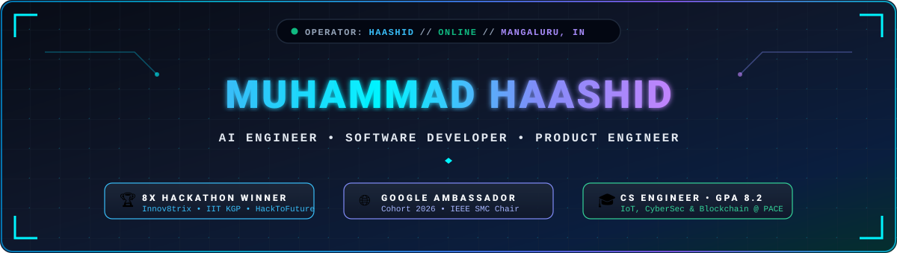
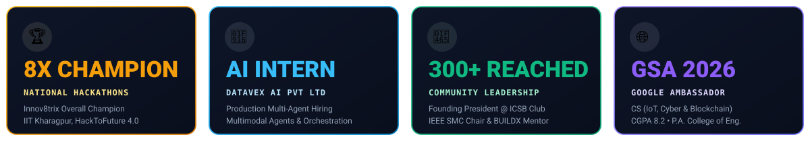
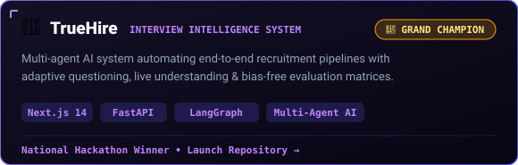
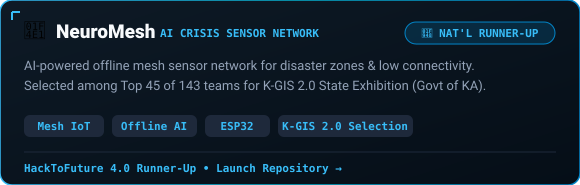
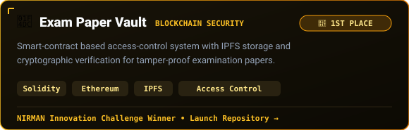
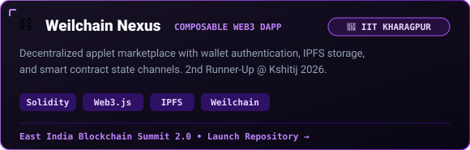

<!-- Modern Vector HUD Header -->


<br />

<!-- Quick Connect & Status Dock -->
<p align="center">
  <a href="https://github.com/haashid">
    
  </a>
  <a href="https://www.linkedin.com/in/muhammad-haashid/">
    
  </a>
  <a href="mailto:haashid.0607@gmail.com">
    
  </a>
  <a href="https://developers.google.com/">
    
  </a>
  <a href="https://github.com/haashid?tab=repositories">
    
  </a>
</p>

<!-- Live Telemetry Badges -->
<p align="center">
  
  
  
</p>


</div>

<br />

## ⚡ `$ haashid --sysinfo --resume`

<p align="center">
  
</p>

```bash
┌──(haashid㉿engineer-station)-[~]
└─$ ./init_profile.sh --verified

[●] NAME            : Muhammad Haashid
[●] TITLE           : AI Engineer | Software Developer | Product Engineer
[●] LOCATION        : Mangaluru, Karnataka, India
[●] CONTACT         : haashid.0607@gmail.com | +91 63608 50145
[●] EDUCATION       : Final-Year B.E., Computer Science (IoT, CyberSec & Blockchain)
[●] INSTITUTION     : P.A. College of Engineering (CGPA: 8.2) | 2023 – 2027
[●] APPOINTMENTS    : Google Student Ambassador (2026) | Chairperson @ IEEE SMC
[●] LEADERSHIP      : Founding President @ ICSB Club (Led 300+ Students)
[●] ACHIEVEMENTS    : 8x National Hackathon Champion (Innov8trix, IIT Kharagpur, HackToFuture)
[●] CORE CODE       : "Learn new stacks fast. Deliver under pressure. Ship production code."
```

> **Final-year Computer Science engineer (GPA: 8.2)** who ships production software, worked with multiple startups, and holds the title of **8x National Hackathon Winner**, **Google Student Ambassador**, and **IEEE SMC Chapter Chair**. Founding President of the **ICSB Club** who has mentored 300+ students, with a proven track record of mastering cutting-edge stacks rapidly and delivering high-concurrency systems under pressure.

<br />

<!-- 4-Card HUD Metrics Deck -->


<br />

<div align="center">

</div>

<br />

## 💼 Professional Experience

<table>
<tr>
<td width="100%" valign="top">

### 🤖 AI Developer Intern — **Datavex AI Pvt Ltd**
*Mar 2026 – Aug 2026*
- Contributed to engineering a **production-grade multi-agent hiring system** featuring specialized multimodal agents for resume analysis, dynamic question generation, live interview understanding, and hiring insights.
- Coordinated agents through a centralized orchestrator to fully automate the end-to-end recruitment workflow.
- Designed and integrated agent workflows combining text, voice, and contextual signals with structured prompting, inter-agent communication, real-time stream processing, and fault handling to advance the system from prototype to reliable production deployment.

`Python` `FastAPI` `LangGraph` `Multi-Agent Orchestration` `Multimodal LLMs` `VectorDB` `Structured Prompting`

</td>
</tr>

<tr>
<td width="100%" valign="top">

### 🔬 Research & Development Intern — **TheROAC** *(Remote)*
*Dec 2025 – Jan 2026*
- Conducted startup market research and evaluated emerging educational technologies for a student-focused upskilling platform, analyzing market fit for student engagement.
- Developed proof-of-concept software architectures and documented technical insights to direct platform development strategy.

`R&D` `Rapid Prototyping` `EdTech Architecture` `Market Analysis` `Technical Documentation`

</td>
</tr>

<tr>
<td width="100%" valign="top">

### 🌐 Web Developer Intern — **Solukraft Co.**
*Jun 2024 – Dec 2024*
- **Improved website performance by ~20%** through code optimization and bug resolution across dynamic client web applications.
- Coordinated internship programs and facilitated intern-mentor communication across the software development team.

`React.js` `JavaScript` `Node.js` `REST APIs` `Web Performance Optimization` `Frontend Architecture`

</td>
</tr>
</table>

<br />

<div align="center">

</div>

<br />

## 🚀 Battle-Tested Flagship Projects

<div align="center">

<table border="0" cellpadding="0" cellspacing="12" width="100%">
<tr>
<td width="50%" valign="top">

<a href="https://github.com/haashid/trueHire-Ai-">
  
</a>

<details>
<summary><b>🔍 System Architecture & Details</b></summary>
<br />
Built a multi-agent AI system automating end-to-end interview workflows, winning <b>Grand Champion</b> honors at a national hackathon. Integrates dynamic questioning, psychometric evaluation, and real-time candidate assessment graphs.
<br /><br />
<code>Next.js 14</code> <code>FastAPI</code> <code>LangGraph</code> <code>Multi-Agent AI</code> <code>VectorDB</code>
<br /><br />
👉 <a href="https://github.com/haashid/trueHire-Ai-"><b>View GitHub Repository →</b></a>
</details>

</td>
<td width="50%" valign="top">

<a href="https://github.com/haashid">
  
</a>

<details>
<summary><b>🔍 System Architecture & Details</b></summary>
<br />
Built an AI-powered offline mesh sensor network for disaster zones and low-connectivity environments.
<br /><br />
🥈 <b>National Runner-Up — HackToFuture 4.0</b><br />
🌟 <b>Selected among Top 45 of 143 teams statewide for K-GIS 2.0 State Exhibition, Govt. of Karnataka.</b>
<br /><br />
<code>IoT Mesh</code> <code>Offline AI</code> <code>ESP32</code> <code>Python</code> <code>K-GIS 2.0</code>
<br /><br />
👉 <a href="https://github.com/haashid"><b>View GitHub Repository →</b></a>
</details>

</td>
</tr>

<tr>
<td width="50%" valign="top">

<a href="https://github.com/haashid">
  
</a>

<details>
<summary><b>🔍 System Architecture & Details</b></summary>
<br />
Built a smart-contract based access-control system with IPFS decentralized storage and cryptographic verification for tamper-proof examination papers.
<br /><br />
🥇 <b>1st Place — NIRMAN Innovation Challenge</b>
<br /><br />
<code>Solidity</code> <code>Ethereum</code> <code>IPFS</code> <code>Web3.js</code> <code>Access Control</code>
<br /><br />
👉 <a href="https://github.com/haashid"><b>View GitHub Repository →</b></a>
</details>

</td>
<td width="50%" valign="top">

<a href="https://github.com/haashid/weilchain-nexus">
  
</a>

<details>
<summary><b>🔍 System Architecture & Details</b></summary>
<br />
Composable Web3 applet marketplace and decentralized execution framework with wallet authentication, IPFS storage, and smart contract escrow.
<br /><br />
🥉 <b>2nd Runner-Up — East India Blockchain Summit 2.0 (IIT Kharagpur · KSHITIJ 2026)</b>
<br /><br />
<code>Solidity</code> <code>Web3.js</code> <code>IPFS</code> <code>Weilchain</code> <code>Smart Contracts</code>
<br /><br />
👉 <a href="https://github.com/haashid/weilchain-nexus"><b>View GitHub Repository →</b></a>
</details>

</td>
</tr>
</table>

</div>

<br />

### 🧪 Additional Engineered Systems

| Project | Domain | Core Tech Stack | Highlights |
|:---|:---|:---|:---|
| **BioFlow** | Environmental Health & IoT | `Python` `IoT Sensors` `MQTT` `Stream Analytics` | Telemetric biological & environmental stream processing |
| **Decentralized Voting System** | Blockchain Governance | `Solidity` `Ethereum` `Web3.js` `Ethers.js` | Cryptographic tamper-proof ballot verification |
| **RFID Attendance System** | Hardware & Edge Systems | `ESP32` `RFID` `C++` `Firebase` `Node.js` | Automated real-time institutional identity logging |
| **Decentralized Photo Storage** | Web3 & Distributed Storage | `IPFS` `Filecoin` `React` `Smart Contracts` | Censorship-resistant encrypted media vault |
| **SehatSetu** | Healthcare Technology | `React` `FastAPI` `PostgreSQL` `Telemedicine` | Telemetric patient diagnostic & health bridge |
| **Raksha AI / FuzzLedger** | Cybersecurity & Blockchain | `Python` `Solidity` `AI Security` `Audit Engine` | Autonomous vulnerability fuzzing & ledger auditor |
| **EchoVerse** | Multimodal Audio AI | `Python` `Audio Processing` `PyTorch` `FastAPI` | Interactive generative sound & voice engine |

<div align="center">

👉 **[Explore All 20+ Production Repositories & Builds →](https://github.com/haashid?tab=repositories)**

</div>

<br />

<div align="center">

</div>

<br />

## 🏆 Honors & Hackathon Victories

<div align="center">

| Placement | Award / Competition | Organizing Entity | Year |
|:---|:---|:---|:---:|
| 🏆 **Overall Champion** | **Innov8rix 2025** | National Tech Championship | 2025 |
| 🥇 **Grand Champion** | **VEXSTORM 2026** (TrueHire AI) | Datavex AI Pvt Ltd | 2026 |
| 🥈 **National Runner-Up** | **HackToFuture 4.0** (NeuroMesh) | SJEC × EG India | 2026 |
| 🥉 **2nd Runner-Up** | **East India Blockchain Summit 2.0** | **IIT Kharagpur** · KSHITIJ 2026 | 2026 |
| 🥇 **1st Place** | **NIRMAN Innovation Challenge** (Exam Paper Vault) | Innovation & Incubation Council | 2025 |
| 🥇 **1st Place** | **IT Manager Competition** | National Level Management Meet | 2026 |
| 🥈 **2nd Place** | **Hackotsava 2025** | National Level Hackathon | 2025 |
| 🥇 **Winner** | **Entrorphosis** | Malnad College of Engineering, Hassan | 2025 |
| 💡 **Best Innovation** | **Udbhava: Spark the Future** | Nitte Institute of Professional Education | 2025 |
| 🌟 **Statewide Selection** | **K-GIS 2.0 State Exhibition** (Top 45 of 143 Teams) | **Government of Karnataka** | 2026 |
| 🥉 **3rd Prize** | **Hack Summit 2024** | Competitive Hackathon | 2024 |

<br />

<!-- GitHub Profile Trophies -->


</div>

<br />

<div align="center">

</div>

<br />

## 🧠 Technical Skills Arsenal

<div align="center">

### 💻 Core Programming Languages


`JavaScript` `Python` `Java` `C/C++` `Node.js` `PHP` `TypeScript`

<br />

### 🌐 Web & Backend Engineering


`Frontend & Backend Development` `React.js` `Next.js 14` `Node.js` `Express.js` `HTML5` `CSS3` `REST API Development` `PHP` `MySQL` `PostgreSQL`

<br />

### 🤖 AI, LLMs & Agentic Systems


`LLMs` `Multi-Agent Orchestration` `LangGraph` `AI Assistant Development` `FastAPI` `VectorDB` `Structured Prompting` `Rapid Prototyping`

<br />

### ⛓️ Blockchain & Web3 Technologies


`Solidity` `Ethereum` `Smart Contracts` `IPFS` `Web3.js` `DApps` `Weilchain` `Cryptographic Verification`

<br />

### 🛠️ DevOps, Runtime & Tools


`Git / GitHub` `Docker` `Nginx` `JWT Authentication` `Postman API Testing` `Linux / Bash` `AI-Assisted Development Tools`

<br />

### 💡 Soft Skills & Leadership DNA
`Team Leadership` • `Community Building` • `Event Management` • `Public Speaking` • `Technical Writing` • `Fast Prototyping`

</div>

<br />

<div align="center">

</div>

<br />

## 👨‍💻 Leadership & Community Impact

### 🏛️ Chairperson — **IEEE Systems, Man & Cybernetics Society (SMC) Student Chapter**
*Feb 2026 – Dec 2026*
* **Established a brand-new IEEE SMC student chapter** at P.A. College of Engineering.
* Spearheading student research symposia, hackathons, and technical initiatives on cybernetics, intelligent systems, and human-machine interaction.

### 👑 Founding President — **ICSB Club (Blockchain, IoT & Cybersecurity)**
*2024 – 2025*
* Founded and scaled a premiere technical student innovation club at P.A. College of Engineering.
* Organized high-impact workshops, expert technical sessions, and hands-on hackathons **engaging and mentoring 300+ students**.

### 🛠️ Lead Resource Person — **BUILDX RC Car Workshop**
* Instructed and mentored 300+ students in an intensive 2-day hands-on embedded robotics workshop at BIT Polytechnic.
* Covered microcontroller architecture, Arduino C/C++ firmware, H-bridge motor drivers, circuit wiring, and live hardware debugging.
* 📰 **Featured in Vartha Bharati Newspaper:** [Read the full press release →](https://english.varthabharathi.in/karavali/bit-polytechnic-hosts-successful-two-day-buildx-workshop-on-building-rc-cars)

---

## 🌐 Google Student Ambassador

<div align="center">

<a href="https://developers.google.com/">
  
</a>

### Selected for the **Global 2026 Cohort**

Empowering student developers across campus, evangelizing modern Google developer platforms, and conducting practical engineering sessions on Cloud, AI, and software architecture.

</div>

<br />

<div align="center">

</div>

<br />

## 🎓 Education & Academic Foundation

```text
┌────────────────────────────────────────────────────────────────────────┐
│  B.E. in Computer Science (IoT, Cybersecurity & Blockchain)            │
│  P.A. College of Engineering, Mangaluru, Karnataka                     │
│  Duration: 2023 – 2027  •  Current CGPA: 8.2 / 10.0                    │
└────────────────────────────────────────────────────────────────────────┘
```

---

## 📊 Live GitHub Contribution & Activity Stream

<div align="center">

<!-- GitHub Contribution Snake Animation -->
<picture>
  <source media="(prefers-color-scheme: dark)" srcset="https://raw.githubusercontent.com/haashid/haashid/output/github-contribution-grid-snake-dark.svg">
  <source media="(prefers-color-scheme: light)" srcset="https://raw.githubusercontent.com/haashid/haashid/output/github-contribution-grid-snake.svg">
  
</picture>

<br /><br />


<br /><br />

<a href="https://github.com/haashid">
  
</a>

</div>

<br />

<div align="center">

</div>

<br />

## 🤝 Let's Connect & Build

Open to:

`⚡ High-Impact AI & Web3 Roles` · `🔬 Startup Engineering` · `🏆 Hackathons` · `🌐 Open Source Systems`

<div align="center">

<a href="https://www.linkedin.com/in/muhammad-haashid/">
  
</a>
<a href="mailto:haashid.0607@gmail.com">
  
</a>
<a href="https://github.com/haashid?tab=repositories">
  
</a>

<br /><br />

<!-- Modern Vector Footer Banner (100% Reliable) -->


</div>
